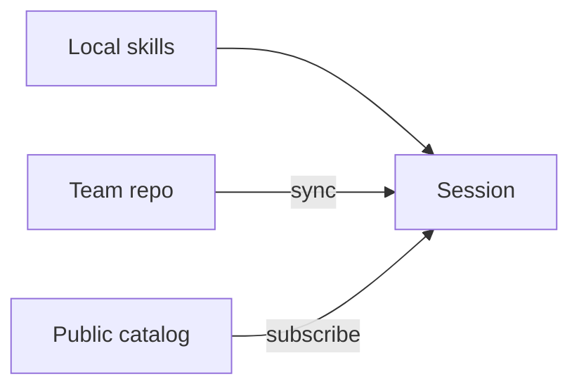

# How Skills Work

A _skill_ is a reusable set of instructions an agent loads when a task calls for it — a pull-request review checklist, a release routine, a way of turning a bug report into a failing test. You write a skill once, then hand it to any session instead of pasting the same instructions into every prompt. PeckBoard keeps skills in three places: on your own instance, in a private git repository your team shares, and in the [public catalog](skills.html).



## The Skill Format

Every skill is a `SKILL.md` file: a short YAML header followed by ordinary Markdown. The format is compatible with Claude-style skills, so a skill written for PeckBoard works with other agents too.

```markdown
---
name: pr-review-checklist
description: Review a pull request and report findings ranked by severity.
version: 1.1.0
tags: [review, git]
groups: [pr-review]
---

# Pull Request Review Checklist

The instructions the agent follows...
```

The `name` is kebab-case (lowercase letters, digits, and dashes, up to 64 characters). The `description` is one line — agents read it to decide whether the skill applies, so say _when_ to use it. `tags` help search, and `groups` puts the skill into named bundles.

## Local, Team, and Public Skills

**Local** skills live in your instance's database. Create one under Settings → Skills → Installed with **+ New skill**, or ask an agent to make one for you. They never leave your machine unless you [publish](#publishing-a-skill) them.

**Team** skills come from a private git repository an admin adds under Settings → Skills → Sources with **+ Team repository**. PeckBoard clones it with the server's own git access (through the API a source can instead use a saved SSH key or a token from an environment variable), syncs it when you choose **Sync now**, and can publish a local skill into it as a commit — so everyone on the team works from the same reviewed set.

**Public** skills come from the [PeckBoard/skills](https://github.com/PeckBoard/skills) repository. Every instance has it as a source out of the box; browse it under Settings → Skills → Browse, or [search it here](skills.html).

## Groups

A _group_ bundles skills that are used together — "PR review skills" holds the review checklist, the security pass, and the commit-message guide. Give a session a group and it gets every skill in it, including skills added to the group later. Manage groups under Settings → Skills → Groups; team and public repos define their own groups in `groups/<slug>.json`.

## Versions

Skills are versioned with [semantic versions](https://semver.org). Editing a skill never changes an existing version: saving creates a new one (a patch, minor, or major bump), and every earlier version stays readable — open a skill to read any version or diff two of them. A published version in a team or public repo is immutable for the same reason — someone may have pinned it.

When you subscribe to a skill you choose either **Latest**, which moves to the newest version each time the source syncs, or a **pinned** version, which stays exactly as it is until you change it. Pick the version in the skill's version selector before you click **Subscribe**; to change it later, open the skill on the Installed tab and pick from **Version in use**.

## Subscribing

Subscribing copies a team or public skill onto your instance so sessions can use it. On Settings → Skills → Browse, search the catalog, open a skill, and click **Subscribe**. From the [catalog page](skills.html), save your instance's address once and use the **Subscribe in PeckBoard** link on any skill — it opens the Skills settings on your instance with that skill ready to subscribe. Unsubscribing removes the copy; sessions that used it lose it the next time their agent starts.

## Publishing a Skill

Only local skills are published. On the Installed tab, choose **Publish…** from a skill's menu (or open the skill and click **Publish…**), pick where it goes, and click **Publish**. The newest version is published, and the [guard](#no-proprietary-content) checks it first.

- **A team repository** — PeckBoard writes `skills/<name>/<version>/SKILL.md` (and the skill's groups) into its clone and pushes a commit. Teammates subscribed to the repo get it when they sync.
- **The public catalog** — nothing is pushed for you. PeckBoard writes the file to `skills/public-outbox/` in its data directory and shows the path, with instructions to open a pull request against [PeckBoard/skills](https://github.com/PeckBoard/skills) adding it; the repository's CI rebuilds the index.

A version that is already in the repository is never overwritten. To publish changes, edit the skill so it gets a new version, then publish again.

## Skills in a Session

Each session has its own set of skills. Open the session's menu, choose **Skills**, and pick skills and groups from the searchable list. An agent that creates a session can give it skills and groups from the start. Changes take effect the next time the session's agent starts.

Every agent sees a short **Available Skills** list (name, version, and description) in its instructions, and loads an assigned skill's full text with the `skill_read` tool when the task calls for it. Claude sessions also get the skills as native Claude Code skills, named `peckboard-skills:<name>`: PeckBoard writes them into a plugin folder for that one session and starts Claude with `--plugin-dir`, so one session's skills never show up in another.

Agents can manage skills too, through the PeckBoard MCP server:

- Skills: `skill_list`, `skill_search`, `skill_get`, `skill_create`, `skill_update`, `skill_delete`
- Groups: `skill_group_list`, `skill_group_create`, `skill_group_update`, `skill_group_delete`
- Subscriptions: `skill_subscribe`, `skill_unsubscribe`, `skill_set_version`
- Sessions: `session_set_skills`, `session_get_skills`, `skill_read`
- Sources and publishing: `skill_source_list`, `skill_source_sync`, `skill_publish`
- Team memory: `team_memory_list`, `team_memory_get`, `team_memory_add`, `team_memory_update`, `team_memory_remove`

## Team Repositories

A team repo is a private git repository with this layout — the same as the public catalog, plus a `memory/` folder:

```
skills/<name>/<version>/SKILL.md   one folder per version
groups/<slug>.json                 {"slug", "name", "description", "skills": [...]}
memory/<slug>.md                   shared team notes (frontmatter: title, updated)
index.json                         generated list of skills, versions, and groups
```

`memory/` holds short shared notes the whole team's agents can read and update — conventions, decisions, where things live — managed under Settings → Skills → Team memory or with the `team_memory_*` tools. Publishing a skill writes a new version folder and pushes a commit; notes are committed the same way, so the repository's history is the audit log.

## No Proprietary Content

The public catalog is public. Before PeckBoard publishes a skill or a team note, a guard scans it for content that must not leave your organisation — private keys, API tokens (AWS, GitHub, Anthropic, OpenAI, Slack), secret-looking values, email addresses, private IP addresses, internal hostnames (`.internal`, `.local`, `.corp`, `.lan`), absolute home-directory paths, and the values of secrets configured on your instance — and refuses, listing each finding with its line (or **Metadata** when it is in the name, description, tags, or groups). The public repository runs the same scan on every pull request.

The scan is a safety net, not a guarantee. Never contribute company-internal procedures, customer names, code, or documents to the public catalog; keep them in a team repo. To contribute a generic skill, follow the [contributing guide](https://github.com/PeckBoard/skills#contributing).
